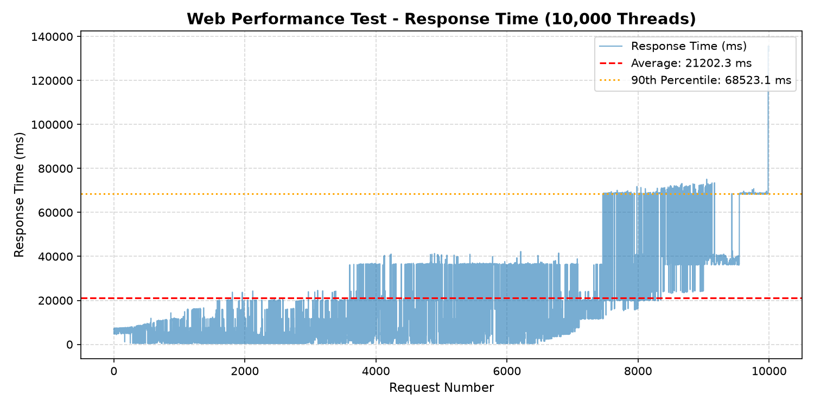
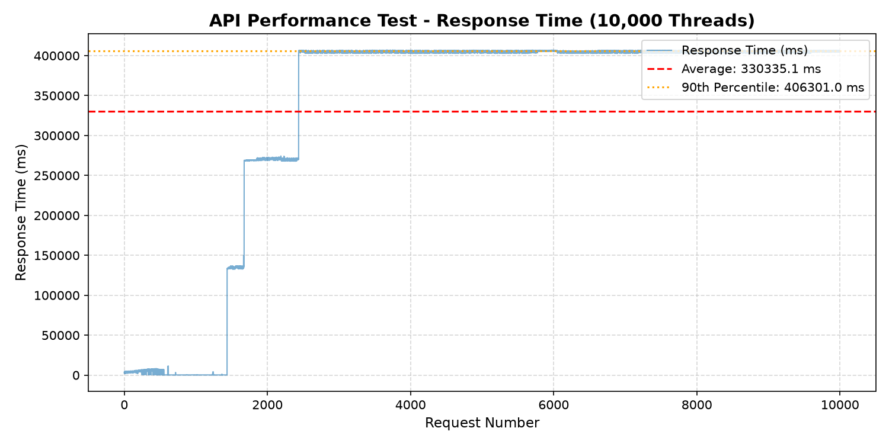

# BÁO CÁO KIỂM THỬ HIỆU NĂNG VỚI APACHE JMETER (10,000 THREADS)

## Thông tin sinh viên
* **Họ và tên:** Nguyễn Ngọc Trọng
* **Mã sinh viên:** 23010763
* **Môn học:** Đánh giá và kiểm định chất lượng phần mềm

---

## BÀI 1: KIỂM THỬ HIỆU NĂNG TRANG WEB (BlazeDemo Web)

### 1. Thông tin kịch bản
* **File kết quả gốc:** `results_web.jtl`[cite: 1]
* **Thời gian thực thi:** 10/14/26, 10:11 AM – 10:13 AM (Thời gian chạy ~2 phút)[cite: 1]
* **Đối tượng kiểm thử:** `HTTP Request - BlazeDemo Web` (`https://blazedemo.com`)[cite: 1, 2]
* **Tổng số lượng mẫu (Samples):** 10,000 requests[cite: 2]

---

### 2. Kết quả & Chỉ số đo lường chi tiết

#### A. Chỉ số tổng quan
* **Tỷ lệ thành công (Pass Rate):** `100.00%` (10,000/10,000 thành công)[cite: 1, 2]
* **Tỷ lệ thất bại (Error Rate):** `0.00%` (0/10,000 lỗi HTTP)[cite: 2]
* **Chỉ số trải nghiệm người dùng (Apdex Score):** `0.126` (Với ngưỡng $T = 500\text{ ms}$, $F = 1,500\text{ ms}$) $\rightarrow$ Mức rất thấp (Unacceptable)[cite: 1].

#### B. Thống kê thời gian phản hồi (Response Time Statistics)
* **Thời gian phản hồi trung bình (Average):** `21,202.30 ms` (~21.2 giây)[cite: 2]
* **Thời gian phản hồi nhỏ nhất (Min):** `287.00 ms`[cite: 2]
* **Thời gian phản hồi lớn nhất (Max):** `135,719.00 ms` (~135.7 giây)[cite: 2]
* **Trung vị (Median / 50th percentile):** `11,650.00 ms` (~11.65 giây)[cite: 2]
* **Percentile 90th:** `68,523.90 ms` (~68.52 giây)[cite: 2]
* **Percentile 95th:** `68,804.00 ms` (~68.80 giây)[cite: 2]
* **Percentile 99th:** `71,543.76 ms` (~71.54 giây)[cite: 2]

#### C. Thông lượng & Băng thông (Throughput & Network)
* **Thông lượng (Throughput):** `68.67 transactions/sec`[cite: 2]
* **Tốc độ nhận (Network Received):** `320.31 KB/sec`[cite: 2]
* **Tốc độ gửi (Network Sent):** `7.51 KB/sec`[cite: 2]

---

### 3. Phân tích & Kết luận bài Web
* **Ưu điểm:** Hệ thống máy chủ Web duy trì xử lý hoàn tất $100\%$ các yêu cầu gửi đến mà không phát sinh lỗi HTTP Error status nào[cite: 1, 2].
* **Hạn chế:** Mặc dù không lỗi, thời gian phản hồi bị kéo dài đáng kể تحت áp lực 10,000 luồng đồng thời (trung bình 21.2 giây, 90% người dùng phải chờ trên 68.5 giây)[cite: 2].
* **Kết luận:** Trang web đạt tiêu chuẩn về độ tin cậy kết nối nhưng **không đạt tiêu chuẩn hiệu năng trải nghiệm người dùng thực tế** khi áp tải 10,000 người dùng ảo đồng thời (Chỉ số Apdex đạt `0.126`)[cite: 1, 2].

---

## BÀI 2: KIỂM THỬ HIỆU NĂNG REST API (ReqRes Users API)

### 1. Thông tin kịch bản
* **File kết quả gốc:** `results_api.jtl`[cite: 3]
* **Thời gian thực thi:** 10/14/26, 10:14 AM – 10:21 AM (Thời gian chạy ~7 phút)[cite: 3]
* **Đối tượng kiểm thử:** `HTTP Request - ReqRes Users API` (`https://reqres.in/api/users?page=2`)[cite: 3, 4]
* **Tổng số lượng mẫu (Samples):** 10,000 requests[cite: 4]

---

### 2. Kết quả & Chỉ số đo lường chi tiết

#### A. Chỉ số tổng quan
* **Tỷ lệ thành công (Pass Rate):** `0.00%` (0/10,000 thành công)[cite: 3, 4]
* **Tỷ lệ thất bại (Error Rate):** `100.00%` (10,000/10,000 thất bại)[cite: 3, 4]
* **Chỉ số trải nghiệm người dùng (Apdex Score):** `0.000` (Với ngưỡng $T = 500\text{ ms}$, $F = 1,500\text{ ms}$)[cite: 3].

#### B. Thống kê thời gian phản hồi (Response Time Statistics)
* **Thời gian phản hồi trung bình (Average):** `330,335.14 ms` (~330.3 giây / ~5.5 phút)[cite: 4]
* **Thời gian phản hồi nhỏ nhất (Min):** `185.00 ms`[cite: 4]
* **Thời gian phản hồi lớn nhất (Max):** `406,983.00 ms` (~406.9 giây)[cite: 4]
* **Trung vị (Median / 50th percentile):** `404,361.00 ms` (~404.3 giây)[cite: 4]
* **Percentile 90th:** `406,301.00 ms` (~406.3 giây)[cite: 4]
* **Percentile 95th:** `406,601.00 ms` (~406.6 giây)[cite: 4]
* **Percentile 99th:** `406,812.99 ms` (~406.8 giây)[cite: 4]

#### C. Thông lượng & Băng thông (Throughput & Network)
* **Thông lượng (Throughput):** `21.55 transactions/sec`[cite: 4]
* **Tốc độ nhận (Network Received):** `52.31 KB/sec`[cite: 4]
* **Tốc độ gửi (Network Sent):** `0.64 KB/sec`[cite: 4]

#### D. Chi tiết các loại lỗi ghi nhận (Error Breakdown)
1. **Lỗi kết nối mạng / Socket (`75.63%` - 7,563 requests):**
   * *Thông báo:* `Non HTTP response code: java.net.SocketException/Non HTTP response message: Network is unreachable`[cite: 4].
   * *Nguyên nhân:* Môi trường thực thi bị cạn kiệt cổng kết nối (Socket exhaustion) hoặc bị ngắt kết nối mạng khi tạo đột biến 10,000 luồng[cite: 4].
2. **Lỗi giới hạn tần suất gửi yêu cầu (`24.37%` - 2,437 requests):**
   * *Thông báo:* `HTTP 429 Too Many Requests`[cite: 4].
   * *Nguyên nhân:* Máy chủ `ReqRes.in` kích hoạt hệ thống bảo vệ chống quá tải / Rate Limiting để ngăn chặn các truy vấn dồn dập[cite: 4].

---

### 3. Phân tích & Kết luận bài API
* **Kết luận:** Mức tải 10,000 người dùng ảo đồng thời đã **vượt quá ngưỡng chịu đựng tối đa (Over-capacity / Stress Limit)** của cả hạ tầng mạng client và máy chủ API `ReqRes`[cite: 3, 4].
* **Đánh giá:** Tỷ lệ lỗi $100\%$ cùng các phản hồi HTTP 429 cho thấy máy chủ API chặn các đợt truy cập bất thường để tự bảo vệ dịch vụ[cite: 3, 4]. Cần hạ thấp mức tải (ví dụ: 100 - 500 threads) hoặc giãn rộng thời gian Ramp-up period để đo lường ngưỡng chịu tải thực sự của API này.